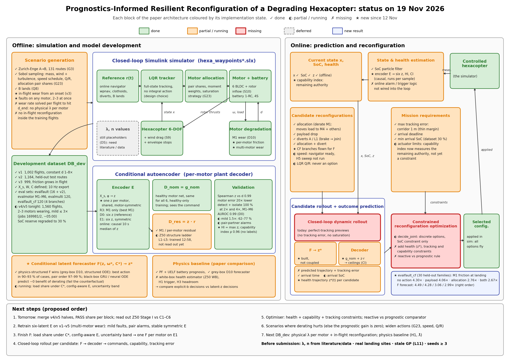

# Starter kit: optimising the reconfiguration of a degrading hexacopter

*Prepared 2026-11-19 from the project "Prognostics-Informed Resilient Reconfiguration of a Degrading Hexacopter".
This kit is for a pilot optimisation framework. It is a subset of the project: enough to understand the problem,
look at real simulated flights and prototype a formulation without MATLAB, Simulink or a GPU.*

## The problem in brief

A hexacopter (6 rotors, 1.6–2.2 kg, 4S battery) flies a delivery mission over a real city map (Zurich-Enge) from
A to B, then lands at B. One motor (M1) degrades in flight: its bearing friction grows, so the motor needs more
current for the same speed and loses thrust authority. If nobody acts, the vehicle may run out of control
authority, miss the deadline, drain the battery or crash.

At a **decision time** t_d we know:
- the vehicle state and the battery state of charge (SoC);
- a learned **health estimate z(t)** of each motor (an autoencoder on onboard data, with no friction sensor);
- a **forecast** of how z will grow under each candidate action (latent forecaster F).

We have to choose a **reconfiguration**:
- how thrust is shared among the motors (allocation);
- whether to drop the payload;
- the speed;
- whether to continue to B or divert to a landing site;
- (later) the controller gains.

The choice must keep the mission feasible: deadline, battery reserve, tracking corridor, safe flight and landing.
It should also limit further damage to the motor.

**Your part:** propose the formalisation and solution strategy for this online constrained decision problem (and,
if useful, for the offline design questions around it). [docs/01_PROBLEM_AND_FORMALIZATION.md](docs/01_PROBLEM_AND_FORMALIZATION.md)
states the problem as precisely as we can today, lists every lever and constraint with its domain, and proposes
pilot problems in increasing order of difficulty.



*The architecture and its implementation state. Red blocks (closed-loop rollout, constrained reconfiguration
optimisation) are the missing pieces where your work fits.*

## Reading order

| # | File | What you get | Time |
|---|---|---|---|
| 1 | this README | overview, folder map, quick start | 5 min |
| 2 | [docs/01_PROBLEM_AND_FORMALIZATION.md](docs/01_PROBLEM_AND_FORMALIZATION.md) | **the decision problem**: decision variables, states, constraints, objectives, uncertainty, structural facts, pilot problems, open questions | 30 min |
| 3 | [notebooks/01_explore_data.ipynb](notebooks/01_explore_data.ipynb) | the map, routes, landing sites, flights, friction effect, health traces, counterfactual branches | 20 min |
| 4 | [notebooks/02_pilot_optimization.ipynb](notebooks/02_pilot_optimization.ipynb) | a worked toy optimisation with the white-box physics (allocation vs wear vs headroom; mission-level option ranking), checked against the counterfactual flights | 20 min |
| 5 | [docs/02_SYSTEM_MODEL.md](docs/02_SYSTEM_MODEL.md) | vehicle, controller, allocation, motor, battery, wind: equations and constants | reference |
| 6 | [docs/03_HEALTH_AUTOENCODER.md](docs/03_HEALTH_AUTOENCODER.md) | the motor-health autoencoder: inputs, outputs, structure, training, accuracy | reference |
| 7 | [docs/04_DEGRADATION_AND_FORECASTER.md](docs/04_DEGRADATION_AND_FORECASTER.md) | the wear law, the health-load feedback loop, the forecaster F | reference |
| 8 | [docs/05_DATA_DICTIONARY.md](docs/05_DATA_DICTIONARY.md) | every file, signal, unit and metadata field in `data/` | reference |
| – | [docs/reference/](docs/reference/) | the project's own specification documents, unchanged (ASSUMPTIONS.md has every value with a tag such as G23, D10, Z36) | as needed |

## Folder map

```
optimization_starter_kit_20261119/
├── README.md                     this file
├── requirements.txt              numpy, scipy, pandas, matplotlib, jupyter (no MATLAB, no torch)
├── docs/
│   ├── 01_PROBLEM_AND_FORMALIZATION.md   ← start here
│   ├── 02_SYSTEM_MODEL.md
│   ├── 03_HEALTH_AUTOENCODER.md
│   ├── 04_DEGRADATION_AND_FORECASTER.md
│   ├── 05_DATA_DICTIONARY.md
│   ├── figures/                  architecture, status, forecaster and wear figures
│   └── reference/                original project specs (ASSUMPTIONS, DATASET, MOTOR_HEALTH_CAE, FORECASTER_STUDY, ...)
├── data/
│   ├── map/                      Zurich-Enge occupancy grid (2 m cells), building footprints, A/B/landing sites
│   ├── routes/                   151 alternative A→B routes (xy polylines), train/test/benchmark split
│   ├── flights/                  76 simulated flights, 50 Hz, 4 subsets (see below) + index.csv
│   ├── health_traces/            1-s health estimates z(t) of 46 of those flights, from 3 trained encoders
│   └── manifests/                metadata + outcome of EVERY flight of the 4 full datasets (2,523 flights, no time series)
├── hexakit/                      small Python package
│   ├── io.py                     loaders: flights, map, routes, traces, manifests
│   └── whitebox/                 project physics in Python: allocation, steady-state trim, wear law, battery
└── notebooks/
    ├── 01_explore_data.ipynb
    └── 02_pilot_optimization.ipynb
```

## The flight subsets

All flights use the same map, start A = (330, 150) m and goal B = (740, 860) m, and fly one of the routes.
Within a **family**, the mission (route, altitude, speed schedule, mass, configuration, mean wind) is identical and
only the motor health (or the action) changes. This makes them natural controlled comparisons.

| Subset (`data/flights/…`) | Source dataset (full size) | M1 friction | Flights in kit | What it is good for |
|---|---|---|---|---|
| `fixed_M1_v2` | DB_dev v2 (1,164) | **constant** during the flight, 1–8× healthy | 30 = 3 test families × 6 levels + 4 train families × 3 | effect of the health level on currents, speeds, SoC, tracking, outcome |
| `growing_M1_v3` | DB_dev v3 (999) | **grows in flight** from an onset (wear law), to 1.5–8× at landing | 18 = 6 families × (healthy, wear from 1×, wear from 1.5–3×) | in-flight degradation, health trajectories |
| `growing_M1_eval` | evalfault_v2 (240) | grows in flight; the same missions as the test families of `fixed_M1_v2` | 16 = 2 families × 8 (2 start levels × 2 onsets × 2 end levels) | the same mission under different fault histories |
| `counterfactual_cf` | evalfault_cf (120) | grows in flight, **one physical wear rate per family** | 12 = 3 families × 4 branches | **the decision problem itself**: identical until t_d, then no action / allocation / payload drop / both |

Families S487 and S496 appear in three subsets (constant, growing, counterfactual), and S501 in two (constant,
counterfactual), so you can follow one mission across them.

`data/manifests/` holds the metadata and graded outcome of all 2,523 flights of the 4 full datasets. That is enough
to fit outcome surrogates, such as P(PASS | friction, mass, wind, allocation, speed). Request the full time series
if you need them (≈ 12 GB).

## Quick start

```bash
python -m venv .venv && source .venv/bin/activate
pip install -r requirements.txt
jupyter lab notebooks/01_explore_data.ipynb
```

```python
import sys; sys.path.insert(0, "..")           # from notebooks/
from hexakit import io, whitebox as wb
idx = io.flight_index()                        # 76 rows: metadata + outcome
f = io.load_flight("F2079")                    # 50 Hz arrays; f["d"] = true M1 friction factor d(t)
m = io.load_map(); routes = io.load_routes()
s = wb.load_model.steady_state(1.9, [2e-4 * 4] + [2e-4] * 5, wb.allocation.AllocConfig(), 15.8)
s["omega"], s["current"]                       # trim rotor speeds [rad/s] and pack current [A] at M1 = 4x
```

Tested with Python 3.10, numpy 2.2, pandas 2.3, scipy 1.15, matplotlib 3.10.

## Important caveats (read before formalising)

1. **Simulation only.** All data comes from a Simulink model, not from a real vehicle. The wear rate λ is a
   placeholder (no literature or test-bench value yet). The landing sites L1–L4 are placeholders, not verified
   landing areas.
2. **M1 cannot be unloaded alone.** The hexacopter geometry couples opposite motors (M1 and M4, M2 and M5, M3 and
   M6): in balanced flight, no allocation can give M1 a different speed from M4 (proof in doc 01, §5). "Unloading
   M1" therefore always means unloading the pair and loading the other four motors.
3. **Motor saturation is a diagnostic, not a failure.** By project rule, a mission fails only through what the
   vehicle does (loss of control, missed deadline, battery reserve, corridor, bad landing), never because a motor
   command touched its limit. Headroom can be a constraint or a robustness margin in your formulation, but the
   outcome labels in the data never use it.
4. **No integral action in the LQR** is a settled design choice (it explains a steady altitude sag of about 13 cm
   and an along-track lag). Please don't treat it as a bug to fix.
5. **DB_dev v3 cannot teach the effect of an action on damage.** In v3 the wear rate was chosen per flight so that
   the friction reaches a sampled end value, whatever the configuration. Use the counterfactual set for anything
   causal (doc 04, §4).
6. Numbers in the docs carry the project's assumption tags (e.g. G23, D10, Z36, FC3). They point to rows of
   [docs/reference/ASSUMPTIONS.md](docs/reference/ASSUMPTIONS.md), where the value, reason and status are recorded.

## What we can provide on request

- More flights or full datasets; new flights flown on the cluster for a candidate policy you specify (≈ 5 min of
  CPU per flight, hundreds per night).
- The trained encoder and forecaster weights (PyTorch) and their code.
- A Python interface to run the simulator in the loop (needs MATLAB R2022b and the Simulink model; cluster only).
