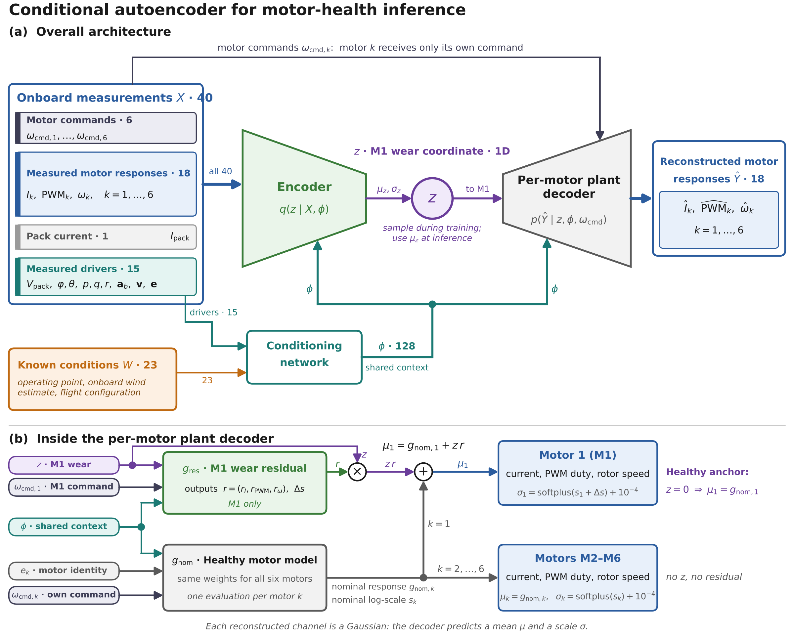

# 3. The motor-health autoencoder: what z is and where it comes from

**For the optimiser, the autoencoder is a sensor.** Every 0.1 s it turns onboard data into a health number z_k
per motor: 0 when healthy, growing with friction. It never sees the friction. The decoder half can also act as a
learned motor model (command → current, PWM, speed for a given health), which the capability index uses.

The full description is in [reference/MOTOR_HEALTH_CAE.md](reference/MOTOR_HEALTH_CAE.md). Every architecture tried
is in [reference/ARCHITECTURES_RECAP.md](reference/ARCHITECTURES_RECAP.md).



*(a) The 40 onboard measurements X are split by role: the commands go to the decoder, everything goes to the
encoder, and the drivers together with the known conditions W form the context φ. (b) The decoder: g_nom, one
healthy-motor network shared by all six motors, plus g_res, the wear effect, scaled by z. A detailed version with
every layer is in [figures/cvae_plant_architecture.pdf](figures/cvae_plant_architecture.pdf).*

## 3.1 Variables

One sample = one 10 Hz instant of one airborne flight (the 50 Hz export thinned by 5). Columns are standardised with
training statistics.

### Input X: onboard measurements (40 columns)

| Group | n | Symbol | Role |
|---|---|---|---|
| Motor currents | 6 | I₁…I₆ | decoder **target** |
| PWM duty | 6 | PWM₁…₆ | decoder **target** |
| Actual rotor speeds (ESC telemetry) | 6 | ω₁…ω₆ | decoder **target** |
| Commanded rotor speeds | 6 | ω_cmd,1…6 | decoder **input**: motor k's model receives its own command |
| Pack voltage | 1 | V_pack | context (driver) |
| Roll, pitch | 2 | φ, θ | context |
| Body rates | 3 | p, q, r | context |
| Accelerometer (body specific force) | 3 | a_b | context |
| Inertial velocity | 3 | v | context |
| Tracking error | 3 | e | context |
| Pack current | 1 | I_pack | encoder only |

### Known conditions W (23 columns)

| Group | n | Content |
|---|---|---|
| Operating point | 13 | commanded speed, altitude reference, flight phase one-hot (climb, hover, cruise, turn, descent), reference velocity (3) and acceleration (3) |
| Onboard wind estimate | 2 | body-frame air velocity x, y, from the accelerometer and the drag law, causal 5 s mean, with realistic errors (±30 % drag coefficient, accelerometer noise) |
| Configuration | 8 | take-off mass, pair shares s₁₄, s₂₅, s₃₆, saturation strategy one-hot (3), M1 ceiling |

**Never inputs:** friction, true wind, SoC, mission outcome. They are used only to evaluate z.

### Output

- **z** (the latent): one number per monitored motor. Online, z = encoder mean, smoothed with a causal 10 s median.
- **Reconstruction** (training only): mean and σ of current, PWM and speed for each motor.

## 3.2 Structure (the current single-motor model, Z36 R3; 421 k parameters)

```
context   φ   = MLP([W, drivers])                                   38 → 256 → 128
encoder   z   = MLP([X, φ])                                         168 → 256 → 256 → 256 → 1   (deterministic)
decoder   for each motor k:  μ_k = g_nom(φ, onehot_k, ω_cmd,k)       135 → 256 → 256 → 6   (same weights ×6)
          M1 only:           μ_1 = g_nom(φ, e_1, ω_cmd,1) + z · r(φ, ω_cmd,1, z)
loss      Gaussian NLL of the 18 motor channels
          + 100·mean(μ_z²) on healthy flights            (anchor: healthy → z = 0)
          + 100·soft wall keeping z in [0, 1]
rule      M1's copy of g_nom learns from healthy flights only (stop-gradient otherwise)
```

**Why it works.** Friction adds a braking torque proportional to the motor's own speed. A decoder that receives each
motor's command can predict a healthy motor's current, PWM and speed almost exactly. The only way to explain a
deviation on M1 is through z. The only label used is a per-flight "healthy" flag (from the design), and only in
the loss.

## 3.3 Variants whose z is in the kit (`data/health_traces`)

| Key | Model | z dimension | Knowledge used in training | Main result (held-out routes) |
|---|---|---|---|---|
| `z_R3` | single latent for M1, plant decoder, dropout 0 (Z36 R3) | 1 | healthy flag; "M1 is the monitored motor" | Spearman(z, friction) 0.991; motor reconstruction error 0.0004 (standardised MSE) |
| `z_D0` | six latents, one per motor, non-symmetric (Z37 D0) | 6 | healthy flag; M1 is the faulty motor in training (z₂…z₆ anchored to 0) | max-z Spearman 0.983, AUROC 0.988; mild-fault (≈1.5×) detection ~77 % |
| `z_E1` | six latents, motor-symmetric (Z38 E1) | 6 | healthy flag only (no fault location) | Spearman 0.983, AUROC 0.968; 100 % detection and isolation at 2× and 4× on any motor, M5/M6 never seen faulty |
| `*_n` | the same, operating-point normalised: z_n = z·(ω̄/ω_ref)^(−α), ω̄ = causal 10 s mean speed of that motor | – | fitted on constant-friction flights (FC19) | removes most of the drop of z when an allocation unloads the motor |

Properties to keep in mind when using z in an optimiser:
- **Concave in log friction.** z rises fast up to ~3× and flattens above. A monotone map z → d can be fitted on
  validation flights (isotonic regression; weak supervision because it uses the friction labels).
- **Depends slightly on the operating point.** A worn motor that is unloaded shows a smaller footprint, so raw z
  drops by ~0.03 within 20 s of an unloading allocation, although friction keeps growing. Use `_n` or model it.
- **Small leaks.** 1 σ of mass or wind shifts z by ≤ 3.4 % / 2 % of the step from 1× to 2× friction.
- **Pair cross-talk.** With six latents, the opposite motor (M4 for M1) can raise false alarms (23 % at 4× in an
  earlier version; the symmetric models halve it).
- **Not a calibrated uncertainty.** σ of the latent is not meaningful; use seeds or ensembles for uncertainty.

## 3.4 How z is used downstream

1. **Detection / trigger** (reactive policy): z (or max_k z_k) crosses a threshold set on healthy flights.
2. **Forecast** (prognostic policy): the history z(≤ t_d) feeds F, which projects z*(t | a) to landing for each
   candidate action (doc 04).
3. **Capability**: the decoder evaluated at full command, for the current z and voltage, gives each motor's
   maximum achievable speed; an LP over the mixer matrix then gives the remaining thrust and moment authority
   (capability index, Spearman 0.96–0.97 with the true capability; [reference/CAPABILITY_INDEX_SPEC.md](reference/CAPABILITY_INDEX_SPEC.md)).
