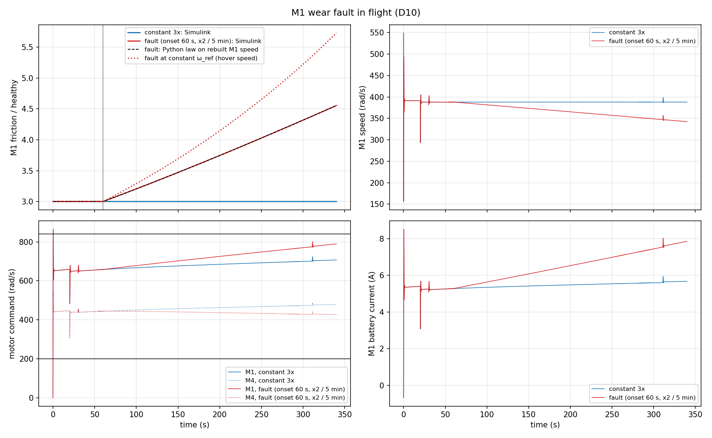
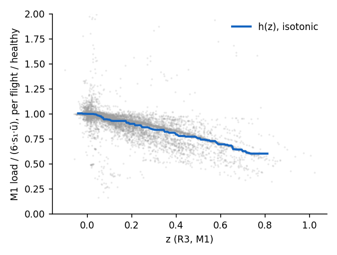
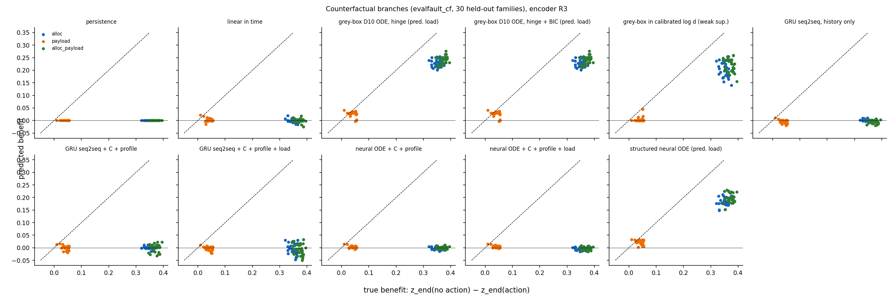

# 4. Degradation: the wear law, the health-load loop, and the forecaster F

Full details: [reference/FORECASTER_STUDY.md](reference/FORECASTER_STUDY.md) and ASSUMPTIONS rows D1–D11, G27, FC1–FC19.

## 4.1 The wear law (D3, D10)

Each motor's viscous friction b grows with the time spent at speed:

```
db/dt = λ(t) · b · (|ω|/ω_ref)ⁿ           ⇒   b(t) = b₀ · exp( λ · E(t) ),   E(t) = ∫ (|ω(τ)|/ω_ref)ⁿ dτ
```

| Symbol | Meaning | Value |
|---|---|---|
| b₀ | friction at take-off | 2e-4 N·m·s/rad × d₀ (d₀ = 1 healthy; 1.5–3 for a pre-worn motor) |
| ω | **actual** rotor speed of that motor | simulated |
| ω_ref | reference speed | 455 rad/s (healthy hover at 1.9 kg) |
| n | speed exponent | 2 (propeller load; default). 7 (bearing fatigue, ISO 281) is a sensitivity |
| λ(t) | rate: background ageing + fault | ageing ln 6 / 100 h (placeholder, negligible within a flight); fault λ_f from the onset t_on |
| E(t) | exposure | the integral of (ω/ω_ref)ⁿ |

So log b is **linear in exposure** (checked on DB_dev v3: r > 0.9998, realised rate / designed rate = 1.000). Only λ is
unknown, and only λ/ω_refⁿ is identifiable. In the data, λ_f is expressed as a doubling time at ω_ref:
λ_f = ln 2 / t_double. Typical values: t_double = 45–300 s (fast in-flight faults).

`hexakit.whitebox.degradation.FrictionWear` implements the closed form, the exposure and the exact
piecewise-constant step.

**Not physical yet.** λ is a placeholder: there is no literature or test-bench value. In DB_dev v3 and evalfault_v2,
λ_f was **solved per flight** so that the friction reaches a sampled end value d_end at landing (using a predicted
mean M1 speed: mean (ω₁/ω_ref)² ≈ 0.342·mass + 2.497·s₁₄ − 0.508). The configuration's effect on the end friction
is therefore cancelled by construction in those sets. **Only the counterfactual set evalfault_cf uses one physical
λ per family** (§4.4).

## 4.2 Why degradation becomes a mission problem



1. Friction rises → for the same PWM, M1 turns slower and draws more current.
2. The LQR sees the missing thrust and pitch moment and raises M1's command (and lowers M4's).
3. The command reaches 840 rad/s; the remaining authority goes to zero; the next gust, turn or the landing cannot be
   compensated → divergence (F1) or a bad landing (F7). At the same time, the higher current drains the battery
   faster (SoC reserve).
4. At hover (1.9 kg, 16 V) M1 alone reaches its limit at ~11× healthy friction; at 2.2 kg and a lower voltage,
   already at 5–7× (D6). In flight, with manoeuvres and wind, failures start much earlier (pass rate 66 % at
   2.3–3.5×, doc 01 §1.5e).

## 4.3 The health-load feedback loop (FC12)

Friction slows its own motor, and the allocation then gives it a smaller share of the thrust. In data:
u₁ / (6·s₁·ū) ≈ 1 − 0.5·z (u = (ω/ω_ref)², s₁ = the motor's allocation share, ū = mean over motors). Since wear grows
with u, **wear slows itself down**. Health → load → wear → health is a closed loop that a forecast must integrate
(an ODE), not a regression in time.



## 4.4 The counterfactual set (the data that matters for decisions)

`evalfault_cf` (FC3): 30 families on held-out routes (3 in the kit: S487, S496, S501). Every family:
- starts healthy (b₀ = 1×), with the fault onset at 25 % of the nominal duration;
- has **one physical wear rate**, chosen so that M1 reaches 6× at landing under the uniform allocation;
- branches at t_d = t_on + 0.35·(T − t_on) into 4 flights that are **bit-identical before t_d**:

| Branch | Action at t_d | PASS (30 families) | Median M1 friction at landing |
|---|---|---|---|
| `none` | – | 63 % | 4.30× |
| `payload` | release 0.15 kg | 70 % | 4.06× |
| `alloc` | legacy allocation weights (4, 1, 1, 1, 1, 1): unloads the M1–M4 pair | 90 % | 2.76× |
| `alloc_payload` | both | 93 % | 2.67× |

(The friction at landing is below 6× for `none` because of the feedback loop in §4.3 and because some flights stop
early.)



## 4.5 The forecaster F

Question at t_d: given z(≤ t_d) and a candidate action a, what will z*(t | a) be until landing? Accuracy on recorded
flights is necessary, but **ranking the candidates correctly is what F is for**.

The configuration, the plan, the mass and the wind do **not** enter as raw features. They enter only through the
motor's future load:

```
dG(z)/dt = λ̂ · h(z) · B(t),     B(t) = ρ̂ · 6·s_k(a) · ū(t; plan, mass, forecast wind)
```

- s_k(a) is the motor's share from the white-box allocation.
- ū is a mean-load model of the planned profile.
- ρ̂ is an online calibration on the last 180 s.
- λ̂ is fitted on the z history: a hinge at an unknown onset, found by grid search, with a BIC change-point test.

Benchmark (encoder R3; evalfault_v2 for accuracy, evalfault_cf for ranking):

| Model | \|z error\| at landing | False growth on constant-friction flights | CF pair order | CF best branch | Predicted allocation benefit (true 0.35) |
|---|---|---|---|---|---|
| persistence | 0.336 | 0.000 | 0.00 | 0.00 | 0.00 |
| linear in time | 0.123 | 0.024 | 0.52 | 0.27 | 0.00 |
| **G5 grey-box ODE (hinge + BIC), predicted load** | 0.085 | 0.037 | **0.98** | **0.93** | 0.21 |
| GRU seq2seq + configuration + profile (black box) | **0.065** | 0.112 | 0.59 | 0.43 | 0.00 |
| neural ODE + true future load (black box) | 0.082 | 0.047 | 0.01 | 0.00 | −0.30 |
| **L3 structured neural ODE** dz/dt = λ(history)·s(z)·u(t) | 0.071 | 0.096 | **0.99** | **0.93** | 0.17 |

**Lesson for the optimiser:** black-box models that are the most accurate on recorded flights predict **no benefit**
from any action, because the training data (v3) contains no causal link between configuration and damage. The
physics-structured models rank actions correctly in 93 % of families. F underestimates the benefit (0.17–0.21 vs
0.35), so it is conservative about acting. Error by time after onset: 0.15 at 30 s, 0.03 at 240 s.

## 4.6 Using this in a pilot

Without the trained F, the white-box version of the same chain works for P2 (doc 01 §1.8):
1. Estimate λ from the friction history over a window before t_d: the slope of log b against exposure. In the kit,
   use the true d(t) for an oracle bound, or fit λ on z after mapping z → d.
2. For each candidate, compute the steady-state ω₁ per phase of the remaining plan (`load_model.steady_state` with
   the candidate allocation and mass), and integrate b forward with `FrictionWear.step`, updating ω₁ as b grows
   (the feedback loop).
3. Integrate the pack current into SoC (`battery.step`), and check headroom (ω_cmd vs 840) along the way.

Notebook 02 does exactly this and compares the result with the flown counterfactual branches.
